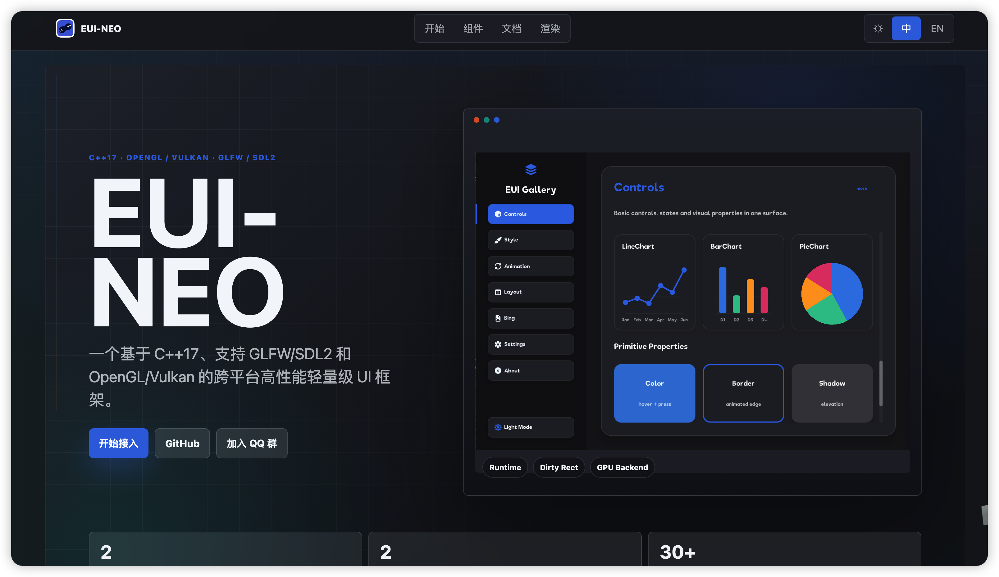
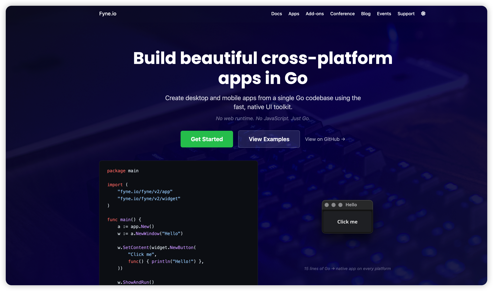
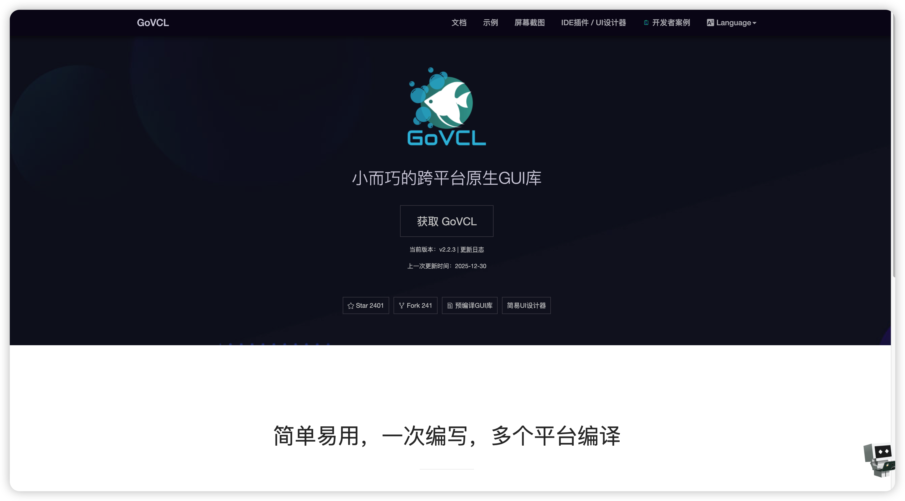
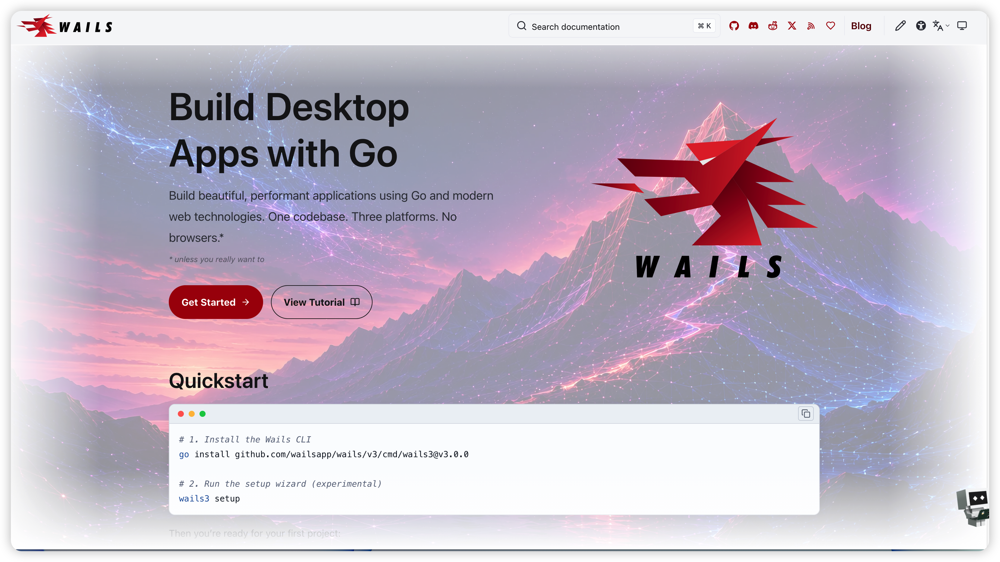
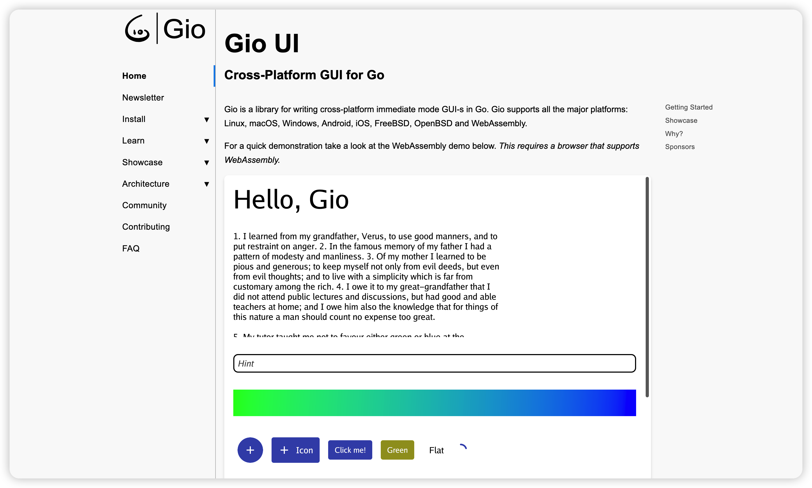
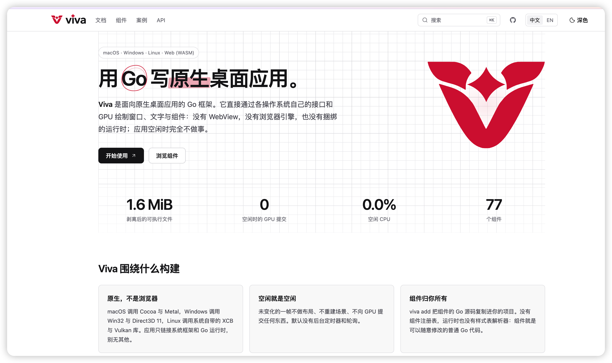
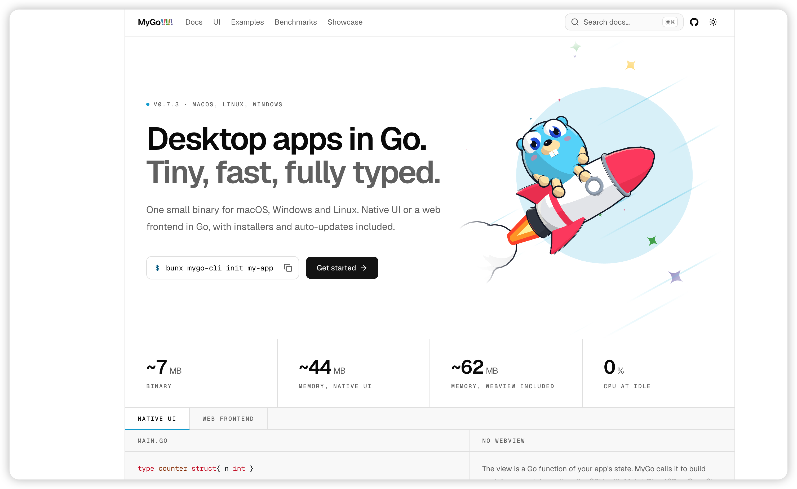

+++
title = "gui框架收集"
date = "2026-05-22"
lastmod = "2026-10-30"
description = "关于各种语言的gui 框架收集"
tags = ["gui"]
categories = ["gui框架"]
draft = false
type = "post"
+++

## c gui 框架
[gtk](https://www.gtk.org/)
GNOME 的 GUI 工具包，用 C 写。Linux 桌面最常用，控件接近系统原生，Windows 和 macOS 也能跑。LGPL。

[imgui](https://github.com/ocornut/imgui)
即时模式 GUI。库本身是 C++ 单头文件，C 里一般用 cimgui。不画系统原生控件，适合工具、调试面板和游戏内界面，渲染后端可以选 OpenGL、Vulkan、DirectX、Metal。MIT。

[lvgl](https://lvgl.io/)
嵌入式 C GUI。面向单片机和小屏幕，自带控件、动画和主题，桌面端可以跑模拟器。MIT。

## c# gui 框架
[winforms](https://learn.microsoft.com/zh-cn/dotnet/desktop/winforms/overview/)
.NET 里最老的 Windows 桌面方案。可视化设计器拖控件，底下是 Win32 原生控件。适合简单业务窗口，只支持 Windows。MIT。

[wpf](https://learn.microsoft.com/zh-cn/dotnet/desktop/wpf/overview/)
用 XAML 和数据绑定做 Windows 桌面，界面由 DirectX 绘制。适合比较复杂的 Windows 应用，只支持 Windows。MIT。

[winui](https://github.com/microsoft/microsoft-ui-xaml)
Windows 现在的原生 UI，Fluent 风格，也是 XAML。跟着 Windows App SDK 发布，只支持 Windows。MIT。

[maui](https://github.com/dotnet/maui)
一套代码覆盖 Android、iOS、macOS 和 Windows，控件用各平台自己的原生实现。Xamarin.Forms 的后继。MIT。

[avalonia](https://github.com/AvaloniaUI/Avalonia)
跨平台 XAML，写法接近 WPF，用 Skia 自己绘制，所以各系统外观一致。支持 Windows、macOS、Linux，也能做到移动端和浏览器。框架是 MIT；另外的 Avalonia XPF 用来兼容 WPF，那个是商业产品。

## c++ gui 框架
[qt](https://www.qt.io/)
跨平台工业级框架。Widgets 是传统控件，QML 是声明式界面，工具链和生态最全。开源协议是 LGPL，闭源商用通常要买商业授权。

[gtk](https://www.gtk.org/)
和 C 那节是同一个库。C++ 可以直接调它的 C 接口，也可以用下面的 gtkmm。

[wxwidgets](https://www.wxwidgets.org/)
把各系统的原生控件包成一套 C++ API，Windows、macOS、Linux 外观接近系统自己的。比 Qt 轻。许可证接近 LGPL，允许闭源发布。

[gtkmm](https://www.gtkmm.org/)
GTK 的官方 C++ 绑定。写起来是 C++，底层还是 GTK。LGPL。

[eui-neo](https://github.com/sudoevolve/EUI-NEO)

C++17 跨平台 UI。声明式 DSL 写布局，窗口用 GLFW 或 SDL2，渲染用 OpenGL 或 Vulkan。自带动画、异步和网络。Apache-2.0。

### c++ 推荐
| 你的需求 | 推荐框架 | 理由 |
|---|---|---|
| 大型商业应用/跨平台工业级 | **Qt** | 生态最完整，Widgets+QML 双模式，IDE 支持好 |
| Linux 原生应用/GNOME 生态 | **gtk/gtkmm** | GNOME 桌面首选，C 接口稳定，多语言绑定丰富 |
| 轻量级/学习成本低 | **wxWidgets** | 原生控件封装，接近系统原生外观 |
| 最美观的现代化 C++ UI | **eui-neo** | C++17，OpenGL/Vulkan 渲染，声明式 DSL 布局，颜值最高，自带动画/异步/网络 |

## python gui 框架
[ttkinter](https://tkinter.com/)
[pyqt6](https://pypi.org/project/PyQt6/)
[pygobject](https://pypi.org/project/PyGObject/)

## java gui 框架
[swing](https://docs.oracle.com/javase/tutorial/uiswing/)
JDK 自带的 Swing。跨平台自绘，各系统外观差不多，不走原生控件。OpenJDK 协议是 GPL，带 Classpath 例外，应用本身可以闭源。

[javafx](https://openjfx.io/)
现在是独立项目 OpenJFX，Java 11 之后不再捆在 JDK 里。场景图加 CSS、FXML，界面用 GPU 绘制。协议同样是 GPL 加 Classpath 例外。

## go gui 框架
[gtk](https://www.gtk.org/)
和 C 那节是同一个库。Go 里用 gotk3 或 gotk4 绑定。

[wxwidgets](https://www.wxwidgets.org/)
和 C++ 那节是同一个库。Go 里通过绑定调用，外观接近系统原生控件。

[fyne](https://fyne.io/)

Go 写的跨平台工具包，Material 风格，OpenGL 自绘。桌面和手机都能用。BSD-3-Clause。

[govcl](https://z-kit.cc/)

Go 绑定 Lazarus 的 LCL，用的是系统原生控件，不是自绘。Windows、Linux、macOS，运行时要带 liblcl。项目已进入维护期，不再加新组件。

[wails](https://wails.io/)

用 Go 加系统自带的 WebView 写桌面应用，前端可以用 Vue、React、Svelte。不打包浏览器。Windows、macOS、Linux。MIT。

[gio](https://gioui.org/)

即时模式，GPU 绘制。Windows、macOS、Linux，也能做到移动端和浏览器。MIT 和 Unlicense 双协议。

[vivaui](https://vivaui.dev/zh/)

用 Go 写桌面应用，直接调系统接口和 GPU：macOS 是 Cocoa 加 Metal，Windows 是 Win32 加 Direct3D 11，Linux 是 X11 加 Vulkan。没有 WebView，只做桌面。组件源码可以拷进自己的项目改。

[mygo](https://mygo.run)

用 Go 做桌面应用。原生界面用 GPU 绘制（Metal、Direct3D、OpenGL），也可以用系统 WebView 写前端。纯 Go，不用 cgo，打出来是一个小可执行文件，还能生成安装包和自动更新。macOS、Windows、Linux。MIT。Zig 的 nanoui 就是从它的原生 UI 移植过去的。

[go-gui](https://github.com/2252688138/Go-gui)
纯 Go、不用 cgo。界面用 OpenGL 自绘，风格接近现代 Web（圆角、渐变、阴影、flex 布局），也可以另带一个系统 WebView。MIT。
文章推荐：[Go-Gui:一套 无限接近 现代化UI的 GPU绘制界面组件框架](https://juejin.cn/post/7701703182474248211?share_token=8ca0fdb2-0a38-4315-9a74-ef5f3c834092)

[nsgo](https://nsgo.dev)
用 Go 写界面，各平台用自己的原生控件画，不嵌浏览器，也不自绘。iOS、macOS、Android、Windows、Linux、网页都有，鸿蒙目前是预览。微信、QQ、支付宝、抖音小程序在试验阶段，包不能超过 2 MB。组件也能用 TSX 写。2026 年 10 月才起步。Apache-2.0。

## dart gui 框架
- [flutter](https://flutter.dev/)

### dart 推荐
| 推荐框架 | 理由 |
|---|---|
| **Flutter** | 全平台覆盖（iOS/Android/Web/Windows/macOS/Linux），Material Design 3 原生级美观，自研 Skia/Impeller 渲染引擎，Dart 语言丝滑热重载，Google 官方维护生态最强 |

## 前端 gui 框架
[electron](https://www.electronjs.org/zh/docs/latest/)
[electrobun](https://github.com/blackboardsh/electrobun)

## php gui 框架
[NativePHP](https://nativephp.com/)

## rust gui 框架
[iced](https://iced.rs)
跨平台桌面 GUI，写法学 Elm：状态放一处，界面是状态的函数。渲染用 wgpu。Windows、macOS、Linux，也能编译到网页。MIT。

[egui](https://www.egui.rs/)
即时模式。每帧把界面重新画一遍，适合工具和调试面板，也能嵌进已有程序。原生和网页都能跑，渲染用 wgpu。Apache-2.0。

[dioxus](https://dioxuslabs.com/)
React 式写法，一套代码覆盖网页、桌面和手机。桌面可以嵌系统 WebView，也有自己的渲染器。Apache-2.0。

[tessera](https://tessera-ui.github.io/zhHans/)
声明式，界面写成普通 Rust 函数。GPU 自绘，后端是 Vulkan、Metal、DirectX 12 或 WebGPU，不走 WebView。Windows、macOS、Linux、Android、iOS 和 Web。Apache-2.0。

[slint](https://slint.dev)
界面写成 `.slint`，自己用 GPU 画。除了 Rust，C++、JavaScript、Python 也能用。桌面、嵌入式和网页都支持。开源协议是 GPL-3.0，闭源商用要买授权。

[tauri](https://tauri.app/)
窗口用系统 WebView，界面是网页，逻辑用 Rust。不自带控件库。桌面和手机都能打包。Apache-2.0。

[gpui](https://github.com/zed-industries/zed)
Zed 编辑器里的 GPU 界面，跟着 Zed 的仓库发布。用来做编辑器这种要自己控制绘制的桌面程序。

[makepad](https://makepad.dev/)
自带一套 DSL，界面可以边改边看。GPU 绘制：macOS 走 Metal，Windows 走 DirectX 11，Linux 走 OpenGL，网页走 WebGL。MIT。

[druid](https://github.com/linebender/druid)
Linebender 早期的 Rust 界面库，数据驱动，用 piet 绘制。已经停更，后继是 [Xilem](https://github.com/linebender/xilem)，还不能当默认选择。Apache-2.0。

[fltk-rs](https://github.com/fltk-rs/fltk-rs)
FLTK 的 Rust 绑定。传统控件，窗口来得快，外观也是传统那一套。Windows、macOS、Linux。绑定本身是 MIT。

[leptos](https://www.leptos.dev/)
用 Rust 写网页，编译成 WebAssembly，细粒度响应式。不负责桌面窗口。MIT。

### 各自适合什么

桌面程序大多在 iced 和 egui 里选。iced 用 Elm 架构，状态和界面分开，设置页、文件管理器这种完整窗口比较合适，桌面这块也最成熟。egui 是即时模式，一帧画完就结束，调试面板、监控和嵌进现有程序更快。

桌面、手机、网页要一起做，差别在界面怎么画出来。Tessera 写成普通 Rust 函数，GPU 自绘，后端是 Vulkan、Metal、DirectX 12 或 WebGPU，不走 WebView，协议 Apache-2.0，项目还比较新。Dioxus 是 React 式写法，可以嵌系统 WebView，也可以自己渲染。手里已经是 Vue 或 React 的，用 Tauri，窗口就是系统 WebView。

编辑器和要自己控制绘制的程序用 gpui，Zed 的界面就是这套。要边改边看的可视化和着色器，用 Makepad。嵌入式屏幕、以及闭源要卖的产品，用 Slint，界面写成 `.slint`，闭源需要商业授权。只求很快弹出一个传统窗口，用 fltk-rs，它包的是 FLTK。

Druid 已经停更，Linebender 的后继是 Xilem，还不能当默认选择。Leptos 是网页框架，不负责桌面窗口。

## zig gui 框架
[nanoui](https://github.com/justrach/nanoui)
Zig 桌面 GUI。原生界面用 GPU 绘制（macOS 走 Metal，Linux 走 OpenGL，Windows 目前是 CPU），也可以嵌系统 WebView。即时模式，flexbox 布局，MIT。从 mygo 的原生 UI 移植而来。

### 喜爱的gui 框架
wails 3.0已发布,好好好
#### wails
Wails 是一个可让您使用 Go 和 Web 技术编写桌面应用的项目。
将它看作为 Go 的快并且轻量的 Electron 替代品。 您可以使用 Go 的灵活性和强大功能，结合丰富的现代前端，轻松的构建应用程序。  

功能:
- 原生菜单、对话框、主题和半透明
- Windows、macOS 和 linux 支持
- 内置 Svelte、React 、Preact 、Vue、Lit 和 Vanilla JS 的模板
- 从 JavaScript 轻松调用 Go 方法
- 自动将 Go 结构体转换为 TypeScript 模块
- Windows 上不需要 CGO 或外部 DLL
- 使用 Vite 的实时开发模式
- 可以轻松创建、构建和打包应用的强大命令行工具
- 丰富的 运行时库
- 使用 Wails 构建的应用程序兼容 Apple & Microsoft 商店

